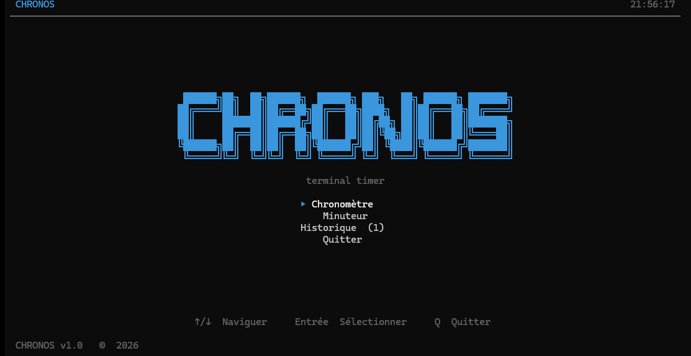
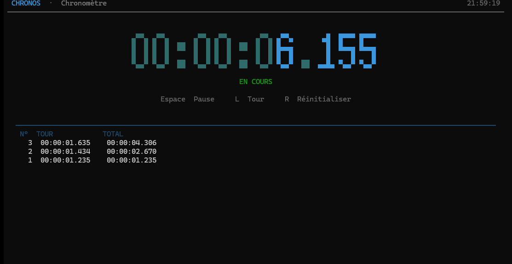
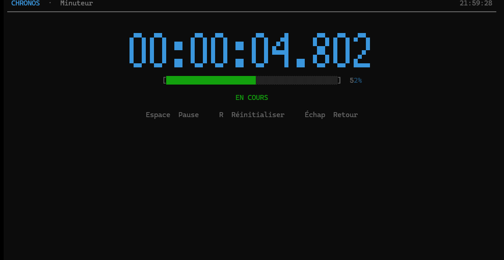

<div align="center">



# Chronos

**Stopwatch, timer and history, right in your terminal.**

<br>


</div>

---

## Features

| Module | Description |
| --- | --- |
|  **Stopwatch** | Start / pause / resume, laps with split and total time, reset that saves the session. |
|  **Timer** | Hours / minutes / seconds setup, progress bar, pause, double beep and a **Windows notification** when it ends — even if the terminal is minimized. |
|  **History** | Every session is persisted (type, duration, date), with per-row deletion or a full clear behind a confirmation. |
|  **Custom TUI** | Cell buffer + *diff* rendering (zero flicker), UTF-8, half-block digits `▀ ▄ █`, automatic resize. |
|  **Zero dependencies** | A single binary, only the libc and the system APIs (Win32 / POSIX). |

## Screenshots

<table>
<tr>
<td></td>
<td></td>
</tr>
<tr>
<td align="center"><b>Stopwatch</b><br><sub>Elapsed time as <code>HH:MM:SS.mmm</code>, numbered laps.</sub></td>
<td align="center"><b>Timer</b><br><sub>Live progress, pause, end-of-timer alarm.</sub></td>
</tr>
</table>

## Build

Requirements: a **C11** compiler (GCC, MinGW-w64 or Clang) and, optionally, `make`.

```sh
make            # or: mingw32-make
```

Without `make`, on Windows:

```bat
build.bat
```

Then:

```sh
./chronos
```

## Keybindings

| Key | Action |
| --- | --- |
| `↑` `↓` | Navigate |
| `Enter` / `Space` | Select, start, pause |
| `←` `→` | Change field (timer) |
| `L` | Record a lap (stopwatch) |
| `R` | Reset (and save the session) |
| `Del` | Delete the row (history) |
| `C` then `C` | Clear the history |
| `Esc` | Back / quit |
| `Q` | Quit |

## Data

The history is stored as plain text in a single file:

- **Windows**: `%LOCALAPPDATA%\Chronos\history.txt`
- **Linux / macOS**: `~/.local/share/Chronos/history.txt`

Format: `C|M <duration_ms> <timestamp>` — one line per session.

## Architecture

```
src/
├── main.c        main loop, navigation, menu & history screens
├── platform.c    time / keyboard / terminal abstraction (Win32 + POSIX)
├── screen.c      UTF-8 cell buffer, diff rendering, ANSI
├── ui.c          boxes, rules, big digits, progress bars
├── stopwatch.c   stopwatch
├── countdown.c   timer + end notification
└── history.c     history persistence
```

**Flicker-free rendering**: each frame is composed into a cell buffer (codepoint + attribute), then only the difference from the previous frame is written to the terminal, cursor repositioned line by line. The refresh runs at ~20 Hz.

**End-of-timer notification**: `Shell_NotifyIcon` shows a "Chronos — Timer finished" balloon through a message-only window; the icon is removed automatically after 6 s.

## Text preview

Every screen can be rendered as plain text, without an interactive terminal — handy for checking the layout:

```sh
./chronos --preview 90 22
```

---

<div align="center">
<sub>Built with C, Unicode blocks and a lot of coffee.</sub>
</div>